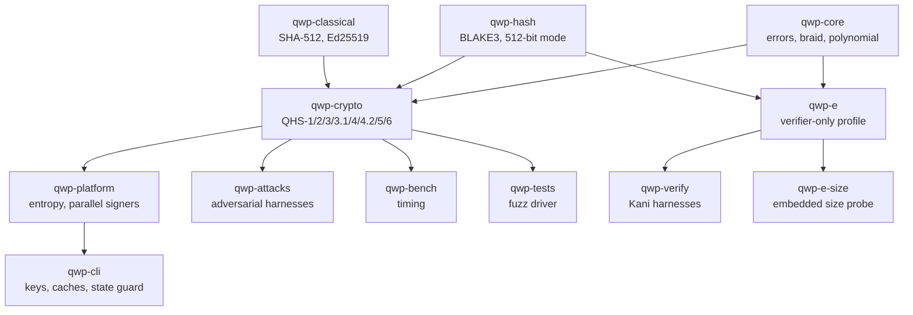

# qWp

**A versioned, post-quantum hash-based signature family written in safe Rust.**

qWp is a from-scratch cryptographic toolkit with a deliberately small trusted
base: no external runtime crates, no unsafe code, a `no_std` cryptographic core,
and explicit version separation for every signature format.

[](https://www.rust-lang.org/)
[](#design-principles)
[](#design-principles)
[](#design-principles)
[](#verification)
[](#the-qhs-family)

---

## Table of contents

- [Why qWp](#why-qwp)
- [The QHS family](#the-qhs-family)
- [Design principles](#design-principles)
- [Architecture](#architecture)
- [Quick start](#quick-start)
- [Command-line interface](#command-line-interface)
- [Verification](#verification)
- [Papers and specifications](#papers-and-specifications)
- [Repository layout](#repository-layout)
- [Security status](#security-status)
- [License](#license)

---

## Why qWp

Hash-based signatures are a conservative answer to a changing cryptographic
landscape: their security rests on preimage and collision resistance rather than
on number-theoretic assumptions. They are also stateful or large, which makes
format discipline and implementation evidence as important as the reduction.

qWp is built around four rules:

- **Zero external runtime crates.** The production workspace uses only
  first-party crates and the Rust core/standard libraries.
- **No unsafe code.** Every crate forbids unsafe code.
- **A `no_std` cryptographic core.** The signature, hash, and classical crates
  do not require the heap, threads, or the operating system.
- **Evidence before release.** Each version has a written construction, format,
  proof, tests, attacks, fuzzing, timing, coverage, mutation, and a one-hour soak.

The project also preserves its research history. The original topological
braid/Jones construction was rejected after a structural break and is retained
only as a research module, outside the production signature path.

---

## The QHS family

| Version | Type | Signature | Public key | Capacity | Security target | Tag |
|---|---|---:|---:|---:|---|---|
| **QHS-1** | Stateful WOTS/Merkle | 2,408 B | 64 B | 256/key | ≥128-bit classical / ≥64-bit quantum | `qhs1-rc1` |
| **QHS-2** | Stateful WOTS/Merkle | 1,704 B | 64 B | 256/key | ≥128-bit classical / ≥64-bit quantum | `qhs2-rc1` |
| **QHS-3** | Stateful WOTS/Merkle | 1,832 B | 64 B | 4,096/key | ≥128-bit classical / ≥64-bit quantum | `qhs3-rc1` |
| **QHS-3.1** | QHS-3 + tree cache | 1,832 B | 64 B | 4,096/key | ≥128-bit classical / ≥64-bit quantum | `qhs31-rc1` |
| **QHS-4** | Stateless FORS/hypertree | 18,216 B | 68 B | ~1,000,000/key | 128-bit classical / ≥64-bit quantum | `qhs4-rc1` |
| **QHS-4.1** | QHS-4 parallel signing | 18,216 B | 68 B | ~1,000,000/key | 128-bit classical / ≥64-bit quantum | `qhs41-rc1` |
| **QHS-4.2** | Compact stateless | 14,344 B | 68 B | ~1,000,000/key | 128-bit classical / ≥64-bit quantum | `qhs42-rc1` |
| **QHS-5** | 512-bit-margin stateful | 6,216 B | 72 B | 256/key | 256-bit classical / ~128-bit quantum | `qhs5-rc1` |
| **QHS-6** | QHS-5 + Ed25519 hybrid | 6,284 B | 108 B | 256/key | Hybrid; secure if either component is secure | `qhs6-rc1` |
| **QHS-E** | Verifier-only profile | same as base | 64 B | n/a | Same as base | `qhse-rc1` |

### Which version should I use?

- **Fast offline stateful signing** → QHS-1.
- **Smaller stateful signatures** → QHS-2.
- **High-capacity stateful signing** → QHS-3; **fast signing** → QHS-3.1.
- **Stateless signing** → QHS-4; **parallel signing** → QHS-4.1; **compact** → QHS-4.2.
- **256-bit classical margin** → QHS-5.
- **Classical hybrid migration** → QHS-6.
- **Bootloader or constrained MCU verifier** → QHS-E.

Stateful versions require a single-writer monotonic counter. Stateless versions
do not. QHS-E is verifier-only and does not generate or sign keys.

---

## Design principles

### Small trusted base

The production workspace is dependency-free. The hash function, classical
component, signature schemes, command-line verifier, and test harnesses are all
in-tree. This makes the trusted base inspectable, at the cost of a larger
first-party audit surface.

### Compiler-enforced code standard

Production crates deny the broad Clippy families, allocation and standard-library
leakage, raw indexing, `unwrap`/`expect`/`panic`/`todo`/`unimplemented`/
`unreachable`, unchecked and lossy casts, floating-point arithmetic, missing
inline annotations, and non-exhaustive structs/enums. Additional lints cover
arithmetic side effects, panic-in-result, ignored must-use values, documentation,
visibility, and lifetimes.

The full policy, crate classes, exceptions, and lint inventory are in the
[code-standard audit](docs/19-code-standard-audit.md) and the papers.

### Version separation

Every version has its own header, domain contexts, signature size, key layout,
cache layout, proof, and release gate. A version is never silently extended.
QHS-3.1 and QHS-4.1 are profiles of QHS-3 and QHS-4: they keep the same keys,
signatures, formats, and proofs, and change only the signing implementation.
QHS-E is a verifier profile, not a new signature format.

### Stateful and stateless signing

Stateful versions consume one leaf per signature and must persist the advanced
counter atomically. The CLI uses a lock file, an atomic key update, and a keyed
state guard. Stateless versions avoid the counter entirely and may be cloned and
run concurrently.

---

## Architecture



**Production crates:** `qwp-core`, `qwp-hash`, `qwp-classical`, `qwp-crypto`,
`qwp-e`.

**Host tooling:** `qwp-platform`, `qwp-cli`, `qwp-attacks`, `qwp-bench`,
`qwp-tests`.

**Proof and evidence:** `qwp-verify`, `qwp-e-size`, standalone fuzz and
verification workspaces under `fuzz/` and `tools/`.

---

## Quick start

```bash
git clone https://github.com/FutureProofsTech/qWp.git
cd qWp

cargo test --workspace --release
cargo run -p qwp-cli --bin qwp -- selftest
```

Build the release CLI:

```bash
cargo build --release -p qwp-cli
./target/release/qwp version
```

Minimum toolchain: Rust 1.99, edition 2024. The production workspace has no
external runtime dependencies.

---

## Command-line interface

The `qwp` binary exposes key generation, signing, verification, self-tests,
hashing, and entropy checks for every version.

### QHS-1

```bash
qwp qhs-keygen public.key private.key
qwp qhs-sign private.key message.txt message.sig
qwp qhs-verify public.key message.txt message.sig
```

### QHS-2, QHS-3, and QHS-3.1

```bash
qwp qhs2-keygen public2.key private2.key
qwp qhs2-sign private2.key message.txt message2.sig
qwp qhs2-verify public2.key message.txt message2.sig

qwp qhs3-keygen public3.key private3.key
qwp qhs3-sign private3.key message.txt message3.sig
qwp qhs3-verify public3.key message.txt message3.sig

qwp qhs31-keygen public31.key private31.key
qwp qhs31-sign private31.key message.txt message31.sig
qwp qhs31-verify public31.key message.txt message31.sig
```

### QHS-4, QHS-4.1, and QHS-4.2

```bash
qwp qhs4-keygen public4.key private4.key
qwp qhs4-sign private4.key message.txt message4.sig
qwp qhs4-verify public4.key message.txt message4.sig

qwp qhs41-sign private4.key message.txt message41.sig
qwp qhs41-verify public4.key message.txt message41.sig

qwp qhs42-keygen public42.key private42.key
qwp qhs42-sign private42.key message.txt message42.sig
qwp qhs42-verify public42.key message.txt message42.sig
```

### QHS-5, QHS-6, and QHS-E

```bash
qwp qhs5-keygen public5.key private5.key
qwp qhs5-sign private5.key message.txt message5.sig
qwp qhs5-verify public5.key message.txt message5.sig

qwp qhs6-keygen public6.key private6.key
qwp qhs6-sign private6.key message.txt message6.sig
qwp qhs6-verify public6.key message.txt message6.sig

qwp qhse-verify 1 public.key message.txt message.sig
```

Run `qwp help` for the complete command list.

### Stateful key handling

Private keys, caches, state guards, and lock files are written with private
permissions (0600 on Unix). Stateful signing requires a single writer. The key
counter is persisted before the signature is released, and the keyed state guard
refuses a corrupt guard, a missing guard for an advanced key, or a guard ahead of
the key counter.

A local software guard cannot detect a rollback of both the key and the guard, or
a guard deletion combined with a counter rollback to zero. Deployments that
require stronger rollback protection should use an external trusted counter, an
HSM, or an append-only remote log.

---

## Verification

qWp is developed with a layered, evidence-first verification programme. The
numbers below are from the current local evidence snapshot.

| Layer | Result |
|---|---|
| Release tests | **308 passed**, 0 failed |
| Attack suite | **20/20** attack groups |
| Signature bit sweep | Every bit of every signature byte; **0 accepted mutations** |
| Structural attacks | Checksum-repaired tampering, WOTS/auth/FORS/layer transplants; **all rejected** |
| Public-key mutation | Every byte of every public key; **all rejected** |
| Cross-version confusion | QHS-1/2/3/4/4.2/5/6; **all rejected** |
| QHS-6 component mixing | Messages, keys, headers; **all rejected** |
| Ed25519 edge cases | Small order, non-canonical, malleability; **all rejected** |
| Kani | **24/24** parser and bounds harnesses |
| Creusot | **7/7** arithmetic contracts |
| AORAI / Frama-C | **1,050/1,051** temporal-order goals |
| libFuzzer | **17,961,180** QHS-E runs; ~29M parser runs each; 0 crashes |
| Proptest | 5 properties × 64 cases + 4 regressions |
| Loom | Chunk-and-join model passes |
| dudect | Valid paths max \|t\| ≤ 1.07; positive control >25,000 |
| cargo-show-asm | No secret-dependent indirect dispatch in the verifier |
| Miri | Classical 30/30; QHS-E guard 1/1 |
| Coverage | QHS-E 98.50% lines / 100% functions; classical 99.67% / 100% |
| Mutation | All survivors classified as equivalent, diagnostic, or test-covered |
| One-hour soaks | QHS-1/2/3/3.1, QHS-4/4.1/4.2, QHS-5, QHS-6, QHS-E |
| QHS-E soak | **28,798,916 iterations**, 0 panics |
| 72-hour soak | Runner and plan prepared; run pending |

Detailed evidence is in [`docs/evidence/`](docs/evidence/). The code-standard
audit and tooling matrix are in
[`docs/19-code-standard-audit.md`](docs/19-code-standard-audit.md).

### Reproduce the local checks

```bash
cargo fmt --all -- --check
cargo clippy --workspace --all-targets --all-features -- -D warnings
cargo test --workspace --release
cargo run -p qwp-attacks --release --bin attack-suite
cargo run -p qwp-attacks --release --bin byte-sweep
cargo run -p qwp-attacks --release --bin audit
```

Optional tooling:

```bash
./scripts/tooling.sh          # libFuzzer, proptest, Loom, dudect, Creusot, AORAI, asm
cargo kani -p qwp-verify
./scripts/soak-72h.sh         # 72-hour all-version soak (run on an idle machine)
```

---

## Papers and specifications

Two long-form documents describe the design and evidence in different styles:

| Document | Content |
|---|---|
| [White paper](docs/whitepaper/qwp-whitepaper.pdf) | 37-page academic overview: design, security, code standard, engineering, verification, results, limitations |
| [Yellow paper](docs/yellowpaper/qwp-yellowpaper.pdf) | 39-page mathematical specification: notation, exact constructions, formulas, bounds, theorem statements, layout tables |

LaTeX sources are in `docs/whitepaper/` and `docs/yellowpaper/`.

Technical documentation:

- [Version family](docs/09-version-family.md)
- [Formats and fixed layouts](docs/03-formats.md)
- [QHS-1 construction and proof](docs/05-qhs1.md)
- [QHS-2 construction and proof](docs/07-qhs2.md)
- [QHS-3 construction and proof](docs/10-qhs3.md)
- [QHS-3.1 tree-cache profile](docs/12-qhs31.md)
- [QHS-4 stateless construction and proof](docs/13-qhs4.md)
- [QHS-4.1 parallel profile](docs/14-qhs41.md)
- [QHS-4.2 compact construction and proof](docs/15-qhs42.md)
- [QHS-5 512-bit-margin construction and proof](docs/16-qhs5.md)
- [QHS-6 hybrid construction and proof](docs/17-qhs6.md)
- [QHS-E embedded verifier](docs/18-qhse.md)
- [Architecture decision records](docs/adr/)
- [Threat model and adversary dossiers](docs/adversary/)
- [Break log](docs/break-log.md)

---

## Repository layout

```text
crates/
  qwp-core/          fixed layouts, braid/polynomial types, errors
  qwp-hash/          in-tree BLAKE3 and 512-bit mode
  qwp-classical/     in-tree SHA-512 and Ed25519
  qwp-crypto/        QHS-1/2/3/3.1/4/4.2/5/6
  qwp-e/             verifier-only embedded profile
  qwp-platform/      safe entropy and parallel signers
  qwp-cli/           qwp command-line interface
  qwp-attacks/       attack harnesses and byte sweep
  qwp-bench/         timing harnesses
  qwp-tests/         fuzz driver and integration tests
  qwp-verify/        Kani proof harnesses
  qwp-e-size/        standalone staticlib size probe

docs/
  adr/               architecture decisions
  adversary/         threat models and FADs
  evidence/          raw verification and soak evidence
  whitepaper/        long-form white paper and LaTeX source
  yellowpaper/       mathematical yellow paper and LaTeX source

fuzz/                libFuzzer targets and standalone fuzz workspace
tools/               proptest, Loom, dudect, Creusot, AORAI workspaces
scripts/             CI, code-standard, tooling, and soak scripts
```

---

## Security status

qWp is **not an external standard** and has **not been independently audited**.
The proofs, tests, attacks, and measurements in this repository are first-party
evidence; they are not a substitute for an independent review.

Known assurance gaps:

- No independent cryptographic or implementation audit.
- No certified compiler path (Ferrocene is not installed).
- QHS-E is at 98.50% line coverage; the remaining lines are defensive branches.
- Formal verification covers parsers, bounds, and arithmetic models, not the
  full Rust verifier plus BLAKE3.
- The QHS-E peak verifier stack is about 6 KB, driven by the BLAKE3 hasher; small
  MCUs must budget for it.
- A local state guard cannot detect a rollback of both the key and the guard, or
  a guard deletion combined with a counter rollback to zero.
- The 72-hour all-version soak is prepared and smoke-tested but has not been run.
- QHS-1's 72-hour soak was waived by owner decision; only the one-hour soak is
  claimed.

Do not use qWp for real security without an independent review of your
deployment.

### Reporting security issues

Please use GitHub's private vulnerability reporting or contact the maintainers
directly. Do not open a public issue for a suspected vulnerability.

---

## License

qWp is proprietary software. The workspace license identifier is
`LicenseRef-qWp`. All rights reserved by the repository owner. Contact
FutureProofsTech for licensing terms.

---

**Maintainer:** nul0 · FutureProofsTech
